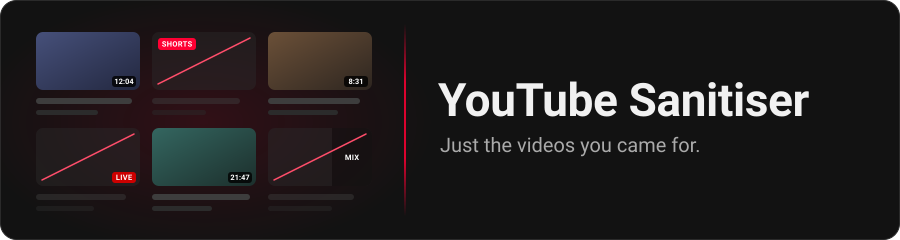
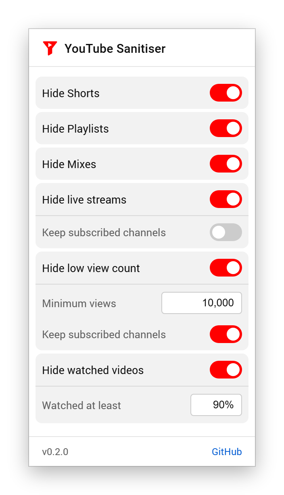

<p align="center">
  
</p>

<p align="center">
  A Chrome extension that hides Shorts, playlists, mixes, live streams<br>
  and low-view videos from YouTube.
</p>

<p align="center">
  <a href="manifest.json"></a>
  <a href="https://github.com/HaXrDEV/youtube-sanitiser/actions/workflows/checks.yml"></a>
  <a href="https://developer.chrome.com/docs/extensions/develop/migrate/what-is-mv3"></a>
  <a href="LICENSE"></a>
</p>

<p align="center">
  <a href="#features">Features</a> ·
  <a href="#install">Install</a> ·
  <a href="#privacy">Privacy</a> ·
  <a href="#development">Development</a>
</p>

<p align="center">
  <picture>
    <source media="(prefers-color-scheme: dark)" srcset="docs/screenshot-dark.png">
    
  </picture>
</p>

## Features

| Filter | Hides | Default |
| :--- | :--- | :---: |
| **Shorts** | Shorts shelves on Home and in search, and Shorts in the sidebar | On |
| **Playlists** | Playlist cards in your feed, search and the sidebar¹ | On |
| **Mixes** | The Mix playlists YouTube generates for you¹ | On |
| **Live streams** | Streams that are live right now. Recordings stay.² | Off |
| **Low view count** | Videos under a minimum you choose, 10,000 by default | Off |

<sub>¹ Still shown on the You page, your playlists and a channel's Playlists tab. ² Still shown on a channel's Live tab.</sub>

- **Instant.** Changes apply to every open YouTube tab, and settings follow you through Chrome sync.
- **Subscriptions exempt.** *Keep subscribed channels* still shows live streams and small videos from the channels you follow.
- **Any language.** View counts are read in every language YouTube offers.

## Install

1. Clone this repository, or download and unzip it.
2. Open `chrome://extensions` and turn on **Developer mode**.
3. Click **Load unpacked** and select the repository folder.

## Privacy

The extension collects nothing and sends nothing anywhere. Settings stay in Chrome's own storage. *Keep subscribed channels* reads your subscriptions from YouTube's sidebar, briefly expanding its *Show more* list, and keeps them in memory only. See the [privacy policy](privacy-policy.md).

## Development

There is no build step and nothing to install. Run the tests with:

```bash
node --test
```

After changing the code, reload the extension on `chrome://extensions` and refresh YouTube. [How it works](docs/how-it-works.md) explains how it finds and hides things.

## License

[MIT](LICENSE)
